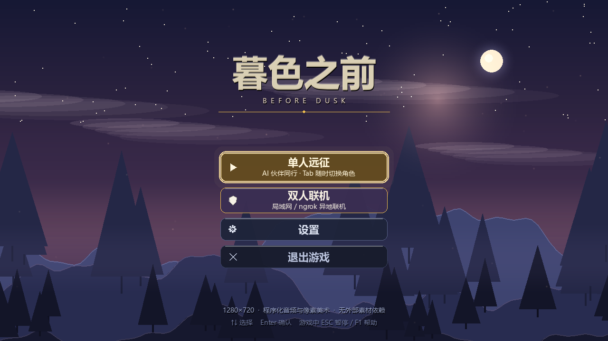
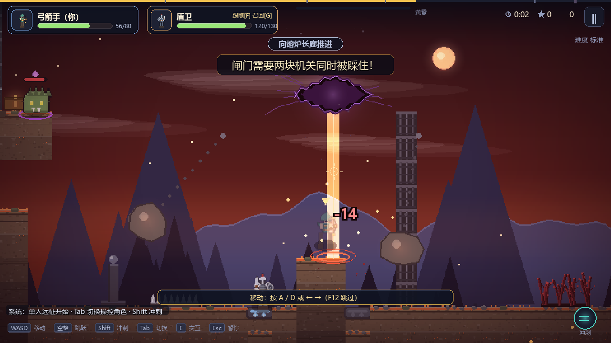
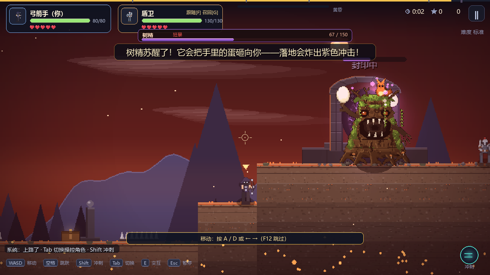

# 暮色之前 · Before Dusk

一款 2D 横版动作闯关游戏：**弓箭手 × 盾卫**双角色协作，横穿暮色森林、岩浆裂隙与熔炉长廊，
在终点祭坛点燃传送门。美术与音频全部在运行时程序化生成——唯一的外部素材是失败丧钟的一段
CC0 真实钟声录音（`assets/sfx/bell.wav`，来源与许可见 `assets/sfx/CREDITS.txt`），缺失时会自动回退到合成钟声。





---

## 快速开始

**方式一（推荐）**：双击 `run.bat` —— 自动挑选已装好 pygame 的解释器，缺依赖会自己安装。
（已经拿到发布包的话，解压后双击 `暮色之前.exe` 即可，不需要 Python。）

**方式二**：命令行

```bash
pip install -r requirements.txt      # pygame + numpy（pyinstaller 仅打包需要）
python main.py
```

首次启动会生成 `settings.json`（音量 / 全屏 / 特效质量），之后自动读取。

---

## 操作

| 功能 | 按键 |
| --- | --- |
| 移动 | `WASD` / `方向键` |
| 跳跃 / 二段跳 | `空格`（或 `W` / `↑`） |
| 冲刺（带 0.22s 无敌帧） | `Shift`（或 `L`） |
| 射箭（弓箭手） | `鼠标左键`，准星瞄准 |
| 挥剑（盾卫） | `J` |
| 格挡（盾卫） | `K` / `鼠标右键` |
| 交互 · 开补给箱 | `E` |
| 切换操控角色（单人） | `Tab` |
| 同伴指令：跟随 / 守点 / 集火 | `F`（可重映射） |

**键位全部可改**：设置 → 操作 → 点击任意一行，按新键即可；冲突会提示并回退旧动作；
「恢复默认键位」一键还原。键位保存在 `settings.json`。

**挑战词条与记录**：选角页下方可选三种词条——玻璃大炮（受伤 ×1.5 / 得分 ×1.5）、
精英狩猎（第二波地面怪全变精英 / ×1.3）、断补给（补给箱失效 / ×1.2），倍率相乘。
通关按「击杀 + 速度 + 通关 - 阵亡」结算分数，结算页显示得分、挑战倍率与历史最佳
（最快用时 / 最高击杀 / 最佳评级 / 最高分），破纪录会标「新纪录」。记录存 `records.json`。

**辅助选项**：设置里有「震屏强度」「受击闪烁」两条独立滑杆，不适可以把震动/红屏拉到 0，不影响判定。

**手柄**：热插拔，左摇杆移动 / A 跳 / B 冲刺 / X 射箭 / Y 格挡 / LB 挥剑 / RB 交互，
右摇杆直接控制弓箭手瞄准方向（推住不放即为瞄准，松开沿用上一次）。
| 聊天 | `Enter` |
| 暂停 / 帮助 / 关闭帮助 | `Esc` / `F1` / `Esc` |

**核心机制**：队伍共享 **5 条生命**。只有**人类玩家**阵亡才扣命——单人模式下 AI 同伴倒下不扣命，
只在人类身边补位复活。每次扣命，场上 Boss 回 **8%** 血，防止"拿命一条条磨"。
生命耗尽 → 世界定格 → **丧钟演出**（血月升起、铜钟三响、红心逐颗碎裂）→ 「长夜降临」结算页。
阵亡后在最近检查点复活，生命恢复至 60%（上限）并附带 1.6 秒无敌。
弓箭手负责击杀飞行怪、远程破墙（3 箭）；盾卫能格挡减伤、踩压力机关生成跳板、近身破墙（2 剑）。换人不如配合。

---

## 内容一览

**三幕地图（总长 5504px，172×28 格）**

| 区段 | 列 | 内容 |
| --- | --- | --- |
| 暮色森林 | 0–45 | 教学地面、压力机关、断崖 + 浮空跳板（45–61 为绿意→焦土的渐变段） |
| 岩壁区 | 56–63 | **焦土/玄武岩材质**、岩石墙（箭 3 下 / 剑 2 下，两人都能破） |
| 岩浆裂隙 | 64–79 | 低洼岩浆、左右往复的移动阶板；**熔炉守卫**从这里升起 |
| 深坑区 | 90–93 | 无底深坑 + 上下往复的刀刺阶板（压到坑底会被扎死；站坑底 7 秒判死回检查点） |
| 熔炉长廊 | 94–158 | **铁板/灰烬/玄武岩材质**、摆锤 ×4、地刺带 ×5、落石 ×3、台阶地形、补给箱、检查点；**114 / 118 列是双人闸门** |
| 终点祭坛 | 159–171 | **树精（终章 Boss）** 在祭坛中央被唤醒；击败后草木复苏、传送门开启 |

**第二波配置**：3 地面兽（首只精英）+ 2 飞蝠 + **2 熔岩术士**

**敌人**

| 名称 | 类型 | 行为 | 解法 |
| --- | --- | --- | --- |
| 地面兽 | 近战地面 | 追击最近的玩家 | 盾卫挥剑 |
| 飞蝠 | 空中 | 俯冲撞击 | 弓箭手射落 |
| **熔岩术士** | 远程空中 | 保持 190–330px 距离，每 2.7s 扔一颗火球 | 射它本体；火球可被**弓箭打爆**，盾卫**举盾可挡下** |
| **精英兽** | 强化地面 | 同地面兽，但血量 ×2.2、伤害 ×1.35，脚下紫环、头顶紫钻 | 盾卫集火，别硬吃 |
| **熔炉守卫** | Boss | 见下 | — |

**同伴指令（单人）**：`F` 在「跟随 / 守点 / 集火」间切换，HUD 的 AI 角色卡上会显示当前指令。
守点会让同伴站上压力机关等你配合；集火会让它主动扑向最近的敌人。AI 不再自动解谜。

**小 Boss · 熔炉守卫**（岩浆坑，第 64–79 列）：玩家靠近岩浆时从岩浆里升起，泡在岩浆表面不会坠落；
跑远会自动沉没（防止软锁）。**三阶段**：一阶段只有「红光蓄力 → 直线冲锋」；血量 66% 起跳砸地，
落地放出贴地冲击波（必须跳起来躲）；33% 起召唤两名熔岩术士（弓箭手清场、盾卫顶住），守卫倒下时术士一起消散。
冲锋**不能按住格挡硬吃**：举盾 0.16 秒内被撞 = 完美格挡，守卫硬直 1.5 秒；一直举盾硬顶会掉 70% 伤害并被击飞。
血量 42，弓箭与挥剑都能打，顶部有独立血条与「蓄力中 / 冲锋！」提示。**血量低于 66% 进入二阶段并狂暴**：
移速 +40%、蓄力缩短到 0.42s、45% 概率立刻接第二次冲锋。另有**岩浆喷发**：脚下先出现收缩红圈，
随后喷出岩浆柱——站原地必吃。

**终章 Boss · 树精**（祭坛，第 159–171 列）：清掉场上的怪、越过第 130 列后在祭坛中央被唤醒，血量 **150**。
两个技能：

- **扔蛋**：抬手后抛出蛋，抛物线落地炸开（伤害 30、半径 84px）。目标**从射程内的活人里随机挑**，
  不再只打最近的——远程位也不安全；半血后狂暴，投掷间隔 1.5s → 0.9s。
- **幽蓝火焰**：仰头蓄力 0.6s，然后喷出锥形火舌，持续伤害并附加**灼烧**（每 0.5s 掉 4 血）。
  盾卫**朝向来火方向举盾**可以挡下。

树精倒下后地面长出草木与花、萤火虫升起，**世界复苏**，随后传送门开启。

**难度选择**：选角页 / 创建房间页可选「简单 / 标准 / 困难」（影响怪物血量与伤害），
和挑战词条叠加计算。

**分步教学**：首次单机开局有 5 步引导（移动→跳跃→冲刺→攻击→格挡），完成即进入下一步，
按 F12 可跳过。联机不给教学（默认两人都会玩）。

**界面缩放**：设置 → 画面 → 界面缩放（90%~140%），放大全部文字，辅助低视力玩家。
（设置页已拆成「音量 / 画面 / 操作」三页，所以能一路放到 140% 而不挤。）

**共鸣门（一守一取）**：瞭望塔二层有一道门，门左侧有守门符文。一人站符文（门开），
另一人进隔间取补给打精英。单机：站符文后按 F 下「守点」，AI 会自动去踩符文替你守门。
符文松手 0.5 秒后门重新关上。

**局域网自动发现**：创建房间后自动向局域网广播；加入方在「加入房间」页会自动列出
发现的房间，点一下就能加入，免手输 IP。跨网络仍建议 ngrok/端口映射。

**双人闸门**：熔炉长廊中段（约第 120 列）有两块相隔 128px 的重型机关，单人踩一块毫无反应。
站上去会出现提示「需要两人同时站上两块机关」，此时按 `F` 把同伴切成「守点」，
它会自动去补你没踩的那一块；两块同时亮起 0.45 秒后闸门升起。联机时由两人各踩一块。

**藤蔓滑索与多层地图**：地图不再是"一层地面"。森林段（10–33 列）有一组断桥，
岩浆段（66–81 列）有一条上层捷径，都由 **6 条**藤蔓滑索连接：
靠近藤蔓按 `空格`/`E` 抓住，左右键沿索滑动；松手方式三种：**松开跳键后再按一次跳**、
按 `E`/`S`（下键），或朝端点方向继续推。滑到端点继续推会自动松手并附带小跳。
按住跳键不放**不会**被甩下来——抓取和松手用的是"重新按下"判定。
全图共 **9 个补给箱**，其中 5 个藏在上层路线上——走上层既是捷径也是收益。

**开局**：前 5 秒没有敌人（或玩家主动向前推进时）才放第一波，留给玩家熟悉移动/瞄准/换人。

**手感细节**：命中定格（30~300ms 世界暂停，击杀 Boss 时最长）、落地压扁与扬尘、怪物死亡淡出上浮、
受击红晕、刀光弧、冲刺残影。
**交互**：检查点（触碰激活、复活点）、补给箱（`E` 开启回血）、压力机关（生成跳板）、传送门。

---

## 技术亮点

- **全程序化音频**（`audio.py`）：numpy 实时合成 4 段循环配乐（菜单 / 探索 / 战斗 / Boss）与 23 种音效，
  含 ADSR 包络、失谐 pad、多抽头混响、软限幅。唯一的外部素材是丧钟录音（CC0），缺文件时自动回退合成。
- **全程序化美术**（`sprites.py` / `renderer.py`）：像素角色自动描边 + 顶光/底影，待机/移动/跳跃/下落/射击/挥剑/格挡等动作帧；
  地形按"暴露深度"分层着色并带草叶与装饰；岩浆/深坑/传送门/摆锤均为代码绘制。
- **镜头与特效**（`fx.py`）：800×450 低分辨率渲染再放大（像素更饱满）、平滑跟随、
  创伤式屏幕震动、粒子池、伤害飘字、视差背景（星空/远山/林线/雾）、暗角与受击红晕。
- **商业 UI**（`theme.py` / `ui.py`）：玻璃面板、按钮悬停发光与扫光、滑块、开关、分段选择器、
  关卡进度条、带残影的血条、冲刺冷却环、Toast 与暂停/结算界面。
- **固定步长**：逻辑 30Hz、渲染 60Hz，用时间累加器驱动，速度与帧率解耦（旧版在 60fps 下会跑成 2 倍速）。
- **联机**：房主权威 TCP 服务器（30Hz 全量状态广播），客户端只发送输入并渲染同步状态。

---

## 工程结构

| 文件 | 作用 |
| --- | --- |
| `main.py` | 场景状态机（菜单/选角/设置/联机/游戏/暂停/结算）、HUD、输入、事件→音效特效 |
| `game_core.py` | 纯逻辑：地图、物理、角色技能、AI、怪物、陷阱、机关、网络封包 |
| `renderer.py` | 世界渲染：地形、岩浆、深坑、陷阱、交互物、传送门、实体、前景 |
| `fx.py` | 相机、粒子、飘字、视差背景、后处理 |
| `theme.py` / `ui.py` | 设计系统与控件库 |
| `audio.py` | 程序化配乐与音效 |
| `sprites.py` | 角色/怪物像素美术与动画帧 |
| `assets.py` | 旧版素材（箭矢、跳板等少量仍在用） |
| `test_gameplay.py` | 玩法专项：检查点/陷阱/补给/冲刺/传送门/Boss/生命池 |
| `test_edges.py` | 边界与异常输入 |
| `test_fuzz.py` | 随机操作长跑（12k tick）防崩与防软锁 |
| `test_fx.py` | 丧钟/红心/生机等演出与状态复位 |
| `test_flow.py` | 场景流转集成测试 |
| `test_move.py` / `test_pit.py` | 移动与深坑专项 |
| `test_lan_weaknet.py` | 联机弱网（限速代理）容错 |
| `test_shots.py` | 离线截图与帧耗时基准（输出到 `shots/`） |

---

## 调参指南

| 想调整 | 位置 |
| --- | --- |
| 地图长度 / 地形 | `game_core.py` → `MAP_W`、`build_static_grid()` |
| 陷阱位置与伤害 | `HAMMER_CFG` / `SPIKE_STRIPS` / `FALL_ROCK_CFG` |
| 检查点、补给箱 | `CHECKPOINT_COLS` / `CHEST_CFG` |
| 冲刺手感 | `DASH_SPEED` / `DASH_TIME` / `DASH_CD` |
| 音量 | 游戏内设置，或 `settings.json` 的 `master/music/sfx` |
| 配色 | `theme.py` 顶部调色板 |

---

## 测试与打包

```bash
python test_gameplay.py    # 玩法专项（全部 PASS 才返回 0）
python test_edges.py       # 边界与异常输入
python test_fuzz.py        # 随机操作长跑，防崩与防软锁
python test_fx.py          # 丧钟 / 红心 / 生机演出与状态复位
python test_flow.py        # 场景流转集成
python test_pit.py         # 深坑专项
python test_audit.py       # 全面体检：输入/事件/按键/UI 控件/联机往返/设置容错
python test_shots.py       # 生成 shots/*.png 并打印帧耗时
python -c "import game_core; game_core.core_selftest()"
build.bat                  # PyInstaller 打包（目录模式）
```

当前基线（本机实测，`test_shots.py`）：逻辑 **0.04ms/tick**；完整画面平均 **12.7ms/帧（79fps）**，
60fps 仍有约 25% 余量。丧钟演出改为"贴冻结快照"后仅约 6ms/帧（原来要重画整个世界，28ms）。

---

## 常见问题

| 现象 | 原因与处理 |
| --- | --- |
| 画面在动但角色不动 | 窗口没拿到键盘焦点。用鼠标点一下游戏画面即可（画面内会给出提示）。 |
| 双击 bat 一闪而过 | 用命令行运行 `run.bat`，会看到具体报错并停住。 |
| 没有声音 | 缺少 numpy 或音频设备被独占；游戏会自动静音继续运行，不影响操作。 |
| 设置乱了想还原 | 删掉 `settings.json`，下次启动恢复默认（损坏的配置也会自动回退）。 |

## 已知限制

- **联机客户端的地形**由客户端本地重建静态地图 + 岩石血量叠加，因此画面的岩石破碎与房主一致，
  但新增滤镜只保证 1:1 同步；联机模式的 UI 提示比单人少。
- **聊天中文输入**依赖 SDL 的 `TEXTINPUT`；部分输入法在 pygame 下只能输入 ASCII，
  这属于 SDL 限制，不影响游戏本体。
- `assets.py` 中的旧角色贴图已不再使用（改由 `sprites.py` 生成），保留仅为兼容。
